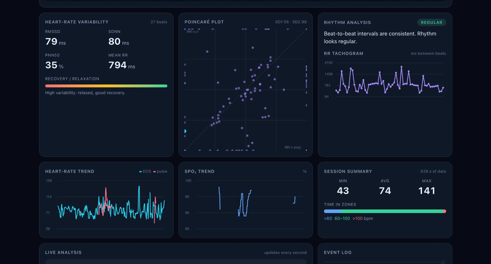
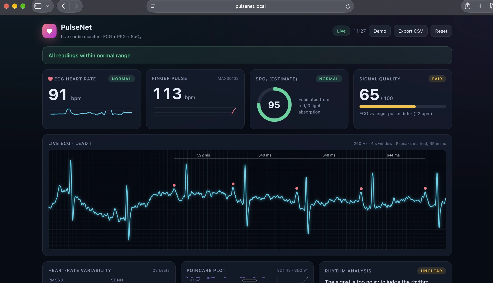
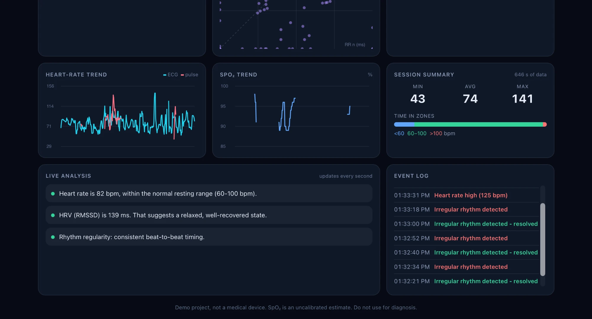

# PulseNet

A small heart monitor built on a WeMos D1 (ESP8266). It reads an ECG from an AD8232 and a finger pulse and SpO2 estimate from a MAX30102, then streams everything over WiFi to a live dashboard that the board hosts itself. Open the page on any phone or laptop on the same network and you see the ECG trace, heart rate, heart rate variability and a few other numbers updating in real time.

I built it as an IoT lab mini project. It is a demo, not a medical device, and the sensors are cheap hobby modules. Read the limitations section before trusting any number it shows.



## What it does

- Samples one ECG lead at 250 Hz and cleans it up on the board (mains hum and baseline drift filters).
- Finds R-peaks with an adaptive threshold and works out beat to beat intervals.
- Measures pulse and a rough SpO2 value from the finger sensor.
- Serves a dashboard from the board itself, over HTTP, and pushes data to it over a WebSocket.
- Computes HRV (RMSSD, SDNN, pNN50), a Poincare plot, a rhythm check, signal quality and heart rate zones in the browser.
- Warns when the electrodes come off.
- Shows the same readings on a small OLED.
- Sets up WiFi from your phone, so there is no password in the code.
- Optional extras, off by default: MQTT telemetry, phone push alerts through ntfy.sh, and a remote viewer page.

## How it is put together

```
 AD8232 ECG ─┐
 MAX30102 ───┼─> WeMos D1 (ESP8266) ──WiFi──> Browser dashboard (http://pulsenet.local)
 OLED <──────┘        │                  HTTP on port 80 for the page
                      │                  WebSocket on port 81 for live data
                      └── optional: MQTT broker, ntfy.sh push alerts
```

The board does the sensing and a first pass at heart rate. The heavier analysis (HRV, rhythm, quality) runs in the browser, because the ESP8266 has very little RAM.

Messages on the WebSocket are plain text:

| Message | Meaning | Rate |
|---|---|---|
| `E:v1,...,v10` | a batch of 10 ECG samples | every 40 ms |
| `V:ecg,ppg,spo2,finger,leadsOff` | current vitals | every 500 ms |
| `R:<ms>` | an R-peak was detected, with the interval since the last one (0 if not valid) | per beat |

## Hardware

| Part | Notes |
|---|---|
| WeMos D1 (ESP8266), USB-C | Needs the "LOLIN(WEMOS) D1 R2 & mini" board setting |
| AD8232 ECG module and 3 pads | Analog output to A0 |
| MAX30102 pulse oximeter | I2C, address 0x57 |
| 0.96 inch SSD1306 OLED, I2C | Address 0x3C |
| Breadboard and jumper wires | |

### Wiring (everything on 3V3)

| Part | Pin | D1 pin |
|---|---|---|
| OLED and MAX30102 | SDA | D14 (GPIO4) |
| OLED and MAX30102 | SCL | D15 (GPIO5) |
| OLED, MAX30102, AD8232 | 3.3V | 3V3 |
| all | GND | GND |
| AD8232 | OUTPUT | A0 |
| AD8232 | LO+ | D12 (GPIO12) |
| AD8232 | LO- | D13 (GPIO14) |
| AD8232 | SDN | not connected |

Electrodes: red (RA) on the right chest under the collarbone, yellow (LA) on the left chest under the collarbone, green (RL) on the lower right ribs.

**Safety.** Unplug the laptop charger while electrodes are on your skin, and never connect the ECG module to mains powered equipment. A battery powered laptop or a power bank is fine. This project is not a medical device.

## Software setup

1. Install Arduino IDE 2 and add the ESP8266 board package (esp8266 by ESP8266 Community, 3.1.2 tested).
2. Install these libraries from the Library Manager:

   | Library | Author |
   |---|---|
   | Adafruit SSD1306 (with its dependencies) | Adafruit |
   | Adafruit GFX Library | Adafruit |
   | SparkFun MAX3010x Pulse and Proximity Sensor Library | SparkFun |
   | WebSockets | Markus Sattler |
   | PubSubClient | Nick O'Leary |
   | WiFiManager | tzapu |

3. Open `PulseNet.ino`. Keep `dashboard.h` in the same folder.
4. Choose the board **LOLIN(WEMOS) D1 R2 & mini** and the board's serial port, then upload.
5. On an Apple Silicon Mac you may need Rosetta once, because the ESP8266 tools ship an Intel Python: `softwareupdate --install-rosetta --agree-to-license`.

## First run

1. The OLED shows **Setup mode**. On your phone join the WiFi network **PulseNet-Setup** (password `pulsenet123`).
2. Open `http://192.168.4.1` in your browser, choose **Configure WiFi**, pick your 2.4 GHz network and enter its password. The cloud fields can stay empty.
3. The board restarts and joins your WiFi. The top line of the OLED shows its IP address.
4. Open `http://<that IP>` or `http://pulsenet.local`.
5. To change WiFi later, open `http://<IP>/setup?confirm=1`. That erases the saved WiFi and reopens the setup hotspot.

If no WiFi is configured within 3 minutes, the board starts its own hotspot called **PulseNet** (password `pulsenet123`) and the dashboard is at `http://192.168.4.1`.

Serial Monitor at 115200 baud prints the free heap, WiFi signal and MQTT state every 10 seconds.

## Dashboard



Open `extras/dashboard.html` directly in a browser to see it in demo mode with a simulated ECG. No hardware needed.

What each panel means:

- **ECG heart rate:** from the R-R intervals, averaged over the last five beats.
- **Finger pulse and SpO2:** from the MAX30102. The SpO2 value uses a textbook ratio-of-ratios formula and is not calibrated. Treat it as an estimate.
- **Signal quality:** based on the ECG amplitude and how consistent the beat intervals are.
- **HRV:** RMSSD, SDNN and pNN50 over the last 40 clean beats, plus a Poincare plot.
- **Rhythm analysis:** flags uneven beat timing, but says "Unclear" when the signal is too noisy to judge. It is not a diagnosis.
- **Trends, session summary, event log, CSV export.**



## ECG signal processing

The ECG is sampled every 4 ms (250 Hz) on the board's 10-bit ADC.

1. A 5-sample moving average. At 250 Hz this puts exact nulls at 50 Hz and 100 Hz, which removes mains hum (India uses 50 Hz) and its harmonic.
2. A first-order high-pass filter at about 0.5 Hz to remove baseline wander. The output is centred at 512.
3. R-peak detection with an adaptive threshold at 75% of the signal range over the last 2 seconds, a 300 ms refractory period, and a validity window of 300 to 2000 ms for each interval. The range includes the deep S-wave, so a lower threshold lets P-waves through.
4. Heart rate is the mean of the last five valid intervals. It resets if no beat is seen for 3 seconds.

## Optional cloud features

All of these are off until you fill in the fields on the setup page.

| Field | What to enter |
|---|---|
| MQTT broker host | For example `broker.hivemq.com`. Blank turns MQTT off. |
| MQTT port | 1883 plain, 8883 TLS |
| MQTT username and password | Needed for private brokers only |
| Device name | Used in the topics. On a public broker anyone who knows it can read your data, so use a long random name. |
| ntfy.sh topic | A long random string. Subscribe to the same topic in the ntfy phone app. |

Topics are `pulsenet/<name>/vitals` (JSON, once a second), `/alert`, and `/status` (`online` or `offline`, set as a Last Will so the broker reports it if the board drops). Alerts fire when heart rate above 120, below 50, or SpO2 below 92 holds for 10 seconds, at most once every 5 minutes per type.

`extras/remote.html` is a viewer that subscribes to those topics over MQTT on WebSockets. Open it in a browser, enter the broker's WebSocket URL (for HiveMQ, `wss://broker.hivemq.com:8884/mqtt`) and your device name.

Port 8883 and ntfy use TLS but do not verify the server certificate. That stops casual eavesdropping and not a determined attacker. A TLS connection also pauses the ECG for one to three seconds while it connects.

## Limitations

- The AD8232 into a 10-bit ADC is a noisy signal. Muscle movement, loose pads and cable movement all show up. The beat detector can still miss or double count beats.
- The finger pulse and the ECG heart rate can disagree. In one of my screenshots they differ by 22 bpm because of poor contact at that moment.
- SpO2 is not calibrated against a reference. Do not read it as a medical value.
- I have not yet measured accuracy against a reference device. `VALIDATION.md` is the plan for doing that, and `extras/analyze_validation.py` computes the error statistics from a filled in log.
- A rhythm or alert message is not a diagnosis. Nothing here is validated for health use.

## Files

| File | Purpose |
|---|---|
| `PulseNet.ino` | Firmware |
| `dashboard.h` | Generated copy of the dashboard that the board serves. Do not edit it by hand. |
| `extras/dashboard.html` | Dashboard source. After editing run `python3 extras/build_dashboard.py` to regenerate `dashboard.h`. |
| `extras/remote.html` | Remote MQTT viewer |
| `extras/build_dashboard.py` | Wraps the HTML into the header file |
| `VALIDATION.md` | Test plan for accuracy and reliability |
| `extras/validation_template.csv` | Logging sheet for the accuracy test |
| `extras/analyze_validation.py` | Turns a filled in log into MAE, bias and limits of agreement |
| `docs/screenshots/` | Dashboard screenshots used in this README |

## Troubleshooting

- **No serial port on a Mac:** use a USB cable that carries data, not a charge-only one. The D1 should show up as `/dev/cu.usbserial-*`.
- **`MAX30105.h: No such file`:** install the SparkFun MAX3010x library.
- **Compile warning about `I2C_BUFFER_LENGTH` redefined:** comes from the SparkFun library and is harmless.
- **Free heap below about 10000 bytes:** TLS will not fit. Use port 1883.
- **OLED shows `ECG off`:** an electrode is loose, or the AD8232 lead-off pins are not wired.
- **Dashboard opens but stays blank:** hard refresh with Cmd+Shift+R, and check that port 81 is reachable on your network.

## Author

Shadbinda (GitHub: shadbindakacham)
